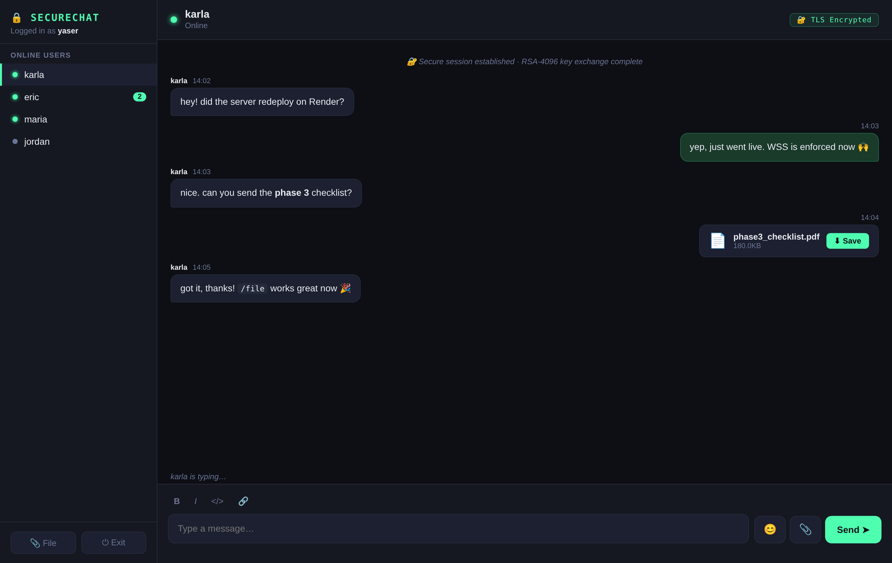
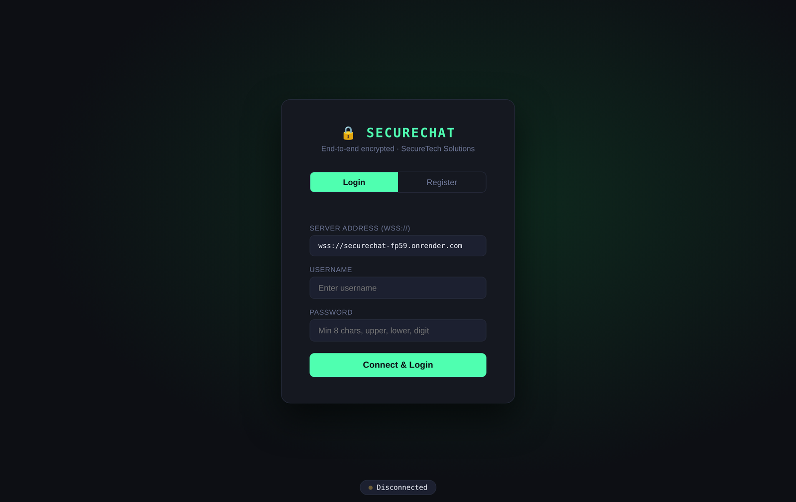
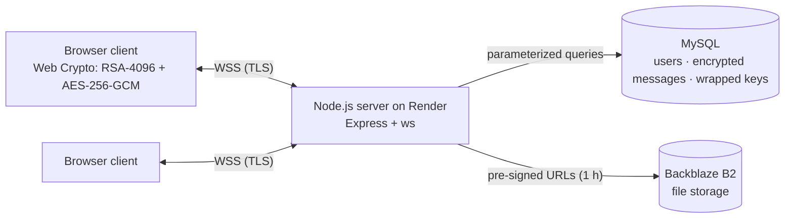

# 🔒 SecureChat

**An end-to-end encrypted, real-time chat app built in three phases: from a terminal prototype to a cloud-hosted web app.**

Messages are encrypted in the browser with AES-256-GCM, and keys are exchanged with RSA-4096, so the server only ever stores ciphertext. Built for CPSC 455 (Web Security) at Cal State Fullerton, Spring 2026.


---

## Screenshots



<details>
<summary>Login screen</summary>



</details>

> The chat screenshot shows the real client UI with sample messages. The hosted server was taken down after grading.

---

## Security features

| Feature | How it works |
|---|---|
| **End-to-end encryption** | Each client generates an RSA-4096 key pair (RSA-OAEP, SHA-256) with the Web Crypto API. A per-conversation AES-256-GCM key is wrapped with each user's public key, so the server never sees plaintext messages or keys. |
| **Key fingerprint verification** | Public keys are fingerprinted with SHA-256. The client remembers each contact's fingerprint and warns on a mismatch, which flags a possible man-in-the-middle. |
| **Password storage** | Passwords are hashed with bcrypt. Registration enforces at least 8 characters with upper, lower, and a digit. |
| **Brute-force protection** | Failed logins are tracked and repeated attempts are blocked. |
| **Rate limiting** | 5 messages per 8 seconds per user, enforced on the client and the server. |
| **Transport security** | TLS from Phase 1. HTTPS and WSS enforced in Phase 3. |
| **SQL injection protection** | All MySQL queries use parameterized statements. |
| **Sessions** | 128-bit random session tokens from `crypto.randomBytes`. |
| **File transfer** | Files go over TLS to Backblaze B2. Downloads use pre-signed URLs that expire after 1 hour. |

## How it evolved

### Phase 1: Terminal prototype
Python `websockets` server and terminal clients. Registration and login with bcrypt, a self-signed TLS certificate, rate limiting, a heartbeat that detects dropped clients and auto-reconnects, and basic `/file` transfer.

### Phase 2: Browser GUI + end-to-end encryption
A browser client (HTML/CSS/JS) on top of an upgraded Python server that handles both GUI and terminal clients. Added end-to-end encryption, brute-force protection, encrypted file transfers, switching between chats, emoji, and chat logs. All authentication moved server-side.

### Phase 3: Cloud hosted
Moved the backend to Node.js (Express + `ws`) on Render, with MySQL for users, encrypted messages, and session keys, and Backblaze B2 for file storage. Added online, offline, and typing indicators, persistent chat history, automatic reconnection, and UptimeRobot monitoring.

## Architecture (Phase 3)



For messages, the server relays and stores **ciphertext only**. Decryption happens in each user's browser.

## Known limitations

- **Files aren't end-to-end encrypted in Phase 3.** They're protected in transit (TLS) and by expiring download links, but client-side encryption before upload was disabled during the cloud migration. Re-enabling it with the existing per-chat AES key is the next step.
- **Trust on first use.** Fingerprints are checked against the first key a client sees, so the first exchange isn't verified out of band.

## Tech stack

| Layer | Tools |
|---|---|
| Client | HTML, CSS, JavaScript, Web Crypto API |
| Server (Phases 1–2) | Python, `websockets`, `bcrypt`, `ssl` |
| Server (Phase 3) | Node.js, Express, `ws`, `bcrypt`, `mysql2` |
| Storage | MySQL, Backblaze B2 (S3 API) |
| Hosting | Render (WebSocket server), UptimeRobot |

## My contributions (Yaser Mohtasebzada)

- **Browser GUI client (Phase 2):** built the first browser client, replacing the terminal UI with login and registration, chat switching, emoji, and file-transfer controls.
- **Server support for the GUI (Phase 2):** updated the Python server to handle GUI and terminal clients side by side, and added brute-force login protection, rate limiting, and per-session chat logging.
- **Client security fixes:** tightened security handling in the terminal client.
- **Documentation:** wrote the project documentation and READMEs for each phase.

## Team

| Member | |
|---|---|
| [Tien Dat (Eric) Le](https://github.com/EricTienLe) | Most of the codebase: servers, encryption, Phase 3 cloud deployment |
| [Yaser Mohtasebzada](https://github.com/Yaser-MohtasebZada) | Phase 2 GUI client and server updates, documentation |
| [Karla Ramirez](https://github.com/karlaAx21) | Documentation |

Copied from the [original team repo](https://github.com/EricTienLe/SecureChat) with the full commit history and branches. The `Phase3` branch is the final version.

## Run it locally (Phase 2)

Phase 3 depends on the team's hosted services, so the easiest version to run yourself is Phase 2, which lives on the `main` branch.

```bash
git clone https://github.com/Yaser-MohtasebZada/SecureChat.git
cd SecureChat
git checkout main
pip install -r requirements.txt

# generate a local self-signed certificate (never commit these files)
openssl req -x509 -newkey rsa:4096 -nodes -days 365 \
  -keyout certificate/privateKey.pem -out certificate/certificate.pem -subj "/CN=localhost"

# the server reads its port from a .env file and the cert paths relative to server/
echo "Server_Port=8765" > server/.env
cd server && python server.py
```

Open `securechat_client.html` in a browser and connect to `wss://localhost:8765`. Because the certificate is self-signed, visit `https://localhost:8765` once and accept the browser warning first.
